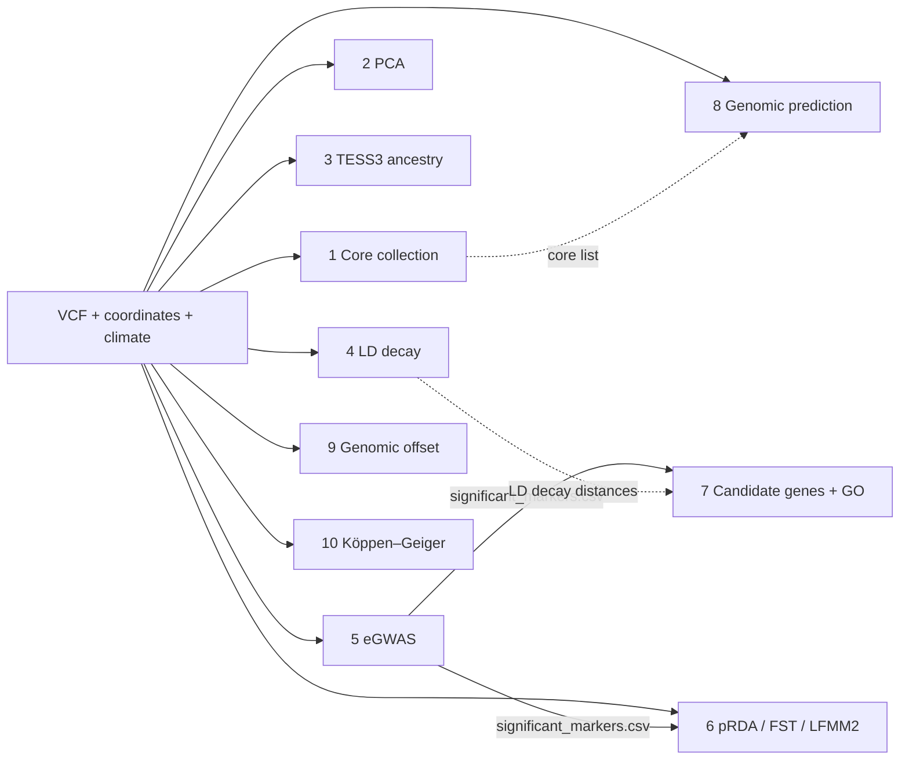

# Finger Millet Genome–Environment Association (GEA)

R scripts for analysing environmental adaptation in finger millet (*Eleusine coracana* subsp. *coracana*) landraces using genome-wide DArTseq SNPs and climate data at the collection sites. The workflow covers population structure, genome–environment association, candidate genes, environmental genomic prediction and climate-change vulnerability (genomic offset and Köppen–Geiger climate shifts).

## Data

| Data | Description | Source |
|---|---|---|
| Genotypes | 8,778 DArTseq SNPs; 404 landraces with collection coordinates | ICRISAT genebank panel genotyped by Bančič et al. (2024) |
| Reference genome | *E. coracana* ML-238 v1.1 (`Ecoracana_560_v1.1`), gene models, annotation release P14, primary-transcript proteins | [Phytozome](https://phytozome-next.jgi.doe.gov/info/Ecoracana_v1_1) (Devos et al., 2023) |
| Climate | WorldClim 2.1 bioclimatic variables and elevation (30 arc-s); CMIP6 projections for the genomic offset | [WorldClim](https://www.worldclim.org) |
| Soil | SoilGrids 2.0 soil properties | [ISRIC SoilGrids](https://soilgrids.org) |
| Climate classes | 1-km Köppen–Geiger maps, 1991–2020 and 2041–2070 (SSP5-8.5) | [GloH2O](https://www.gloh2o.org/koppen) (Beck et al., 2023) |
| Gene Ontology | `go-basic.obo` (downloaded automatically by the GO script) | [Gene Ontology](https://geneontology.org) |

Genotype and climate input files are not included in this repository. [Add a data availability statement or archive link here.]

**Chromosome names.** The VCF exported from TASSEL numbers chromosomes 1–19. The scripts map 1–18 to the reference chromosomes 1A, 1B, 2A, 2B … 9A, 9B. Chromosome 19 holds the 682 SNPs on unplaced scaffolds, which are used in genome-wide analyses but not in sub-genome or gene-level analyses.

## Scripts

| # | Script | Analysis | Main outputs |
|---|---|---|---|
| 1 | `finger_millet_core_identification.R` | Core collection of 100 accessions (Core Hunter 3, entry-to-nearest-entry criterion, Modified Rogers' distance) | Core accession list |
| 2 | `finger_millet_PCA_Analysis.Rmd` | PCA on LD-pruned SNPs (SNPRelate) | PC scores, variance explained, PCA plots |
| 3 | `finger_millet_interpolation.R` | Spatial ancestry with TESS3 (K = 1–8) and kriged ancestry maps | Ancestry coefficients, cross-validation plot, ancestry maps |
| 4 | `LD_decay_analysis.Rmd` | Linkage disequilibrium decay per chromosome and genome-wide | LD decay curves and decay distances |
| 5 | `environmental_gwas_complete.R` | Environmental GWAS with six mixed models (rrBLUP); variance explained per significant marker | Significant markers with PVE, QQ plots (all models per panel), Manhattan plots, allele maps, HTML report |
| 6 | `finger_millet_pRDA_FST_LFMM.R` | Partial RDA and variance partitioning (vegan), Weir & Cockerham F<sub>ST</sub> outliers, LFMM2 (LEA) | RDA summaries and permutation tests, F<sub>ST</sub> outliers, LFMM2 associations |
| 7 | `candidate_genes_fingermillet_GO.R` | Candidate genes around eGWAS hits and Gene Ontology enrichment | Candidate gene table, GO enrichment tables, lollipop, UpSet and gene × term figures |
| 8 | `finger_millet_genomic_prediction.R` | Environmental genomic prediction at whole-genome and sub-genome (A/B) level; core collections as training sets; within-population GEAVs and candidate parents | Prediction accuracies with bootstrap CIs, sub-genome variance partition, GEAV heatmaps |
| 9 | `finger_millet_genomic_offset_revised.R` | Genomic offset (genetic gap, LEA) under SSP5-8.5, 2081–2100, six CMIP6 models, with extrapolation masking | Offset and uncertainty maps (PDF, GeoTIFF), per-accession offsets |
| 10 | `koppen_geiger_climate_change_analysis_finger_millet.R` | Change in Köppen–Geiger climate class at each collection site | Historical, future and change maps; per-population summaries |

`candidate_genes_generic.R` is a species-independent version of script 7 (GFF3 or GTF, any VCF and association table) and is not needed for the finger millet analysis.

## Workflow



Scripts 1–6 and 8–10 can be run independently. Script 7 needs `significant_markers.csv` from script 5. Script 6 also uses it, optionally, to flag LFMM2 associations shared with the eGWAS. Script 8 can evaluate the core list from script 1 as a training set.

## Running the scripts

Each script has a settings block at the top (input paths, thresholds, models, output folder); edit it before running. Script 7 can also take its input and output folders from the command line:

```bash
Rscript environmental_gwas_complete.R
Rscript candidate_genes_fingermillet_GO.R <input_folder> <output_folder>
Rscript finger_millet_pRDA_FST_LFMM.R
```

`candidate_genes_fingermillet_GO.R` finds its input files by name pattern anywhere under the input folder (VCF, `significant_markers.csv`, Phytozome `gene.gff3`, `annotation_info`, `defline`, optional `go-basic.obo`).

Figures are written as PDF (vector) and, for most scripts, also PNG.

### Input files

| File | Used by |
|---|---|
| `finger_millet_404.vcf` (DArTseq SNPs) | all scripts |
| Coordinates CSV: `SampleID, Latitude, Longitude, Population` (or `Region`, `Country`) | 3, 5, 6, 8, 9, 10 |
| Environmental CSV: `SampleID` + bioclimatic / soil variables | 5, 6, 8 |
| `Ecoracana_560_v1.1.gene.gff3.gz`, `…P14.annotation_info.txt.gz`, `…P14.defline.txt.gz` | 7 |
| Köppen–Geiger GeoTIFFs (`koppen_geiger_0p00833333.tif`, 1991–2020 and 2041–2070/ssp585) | 10 |
| WorldClim / CMIP6 layers (downloaded and cached automatically) | 9 |

## Requirements

- R ≥ 4.2
- Unix tools `gzip`, `awk`, `grep` and `cut` (standard on Linux and macOS; on Windows use WSL) for scripts 7 and `candidate_genes_generic.R`
- Java for `corehunter`

```r
install.packages(c("data.table", "dplyr", "tidyr", "purrr", "tibble", "ggplot2", "patchwork",
                   "maps", "terra", "geodata", "rrBLUP", "BGLR", "ranger", "vegan",
                   "corehunter", "vcfR", "fields", "rworldmap"))
install.packages("BiocManager")
BiocManager::install(c("LEA", "SNPRelate", "qvalue"))
remotes::install_github("bcm-uga/TESS3_encho_sen")   # tess3r
```

Most scripts install missing CRAN packages automatically. `qvalue` is optional; the eGWAS falls back to Benjamini–Hochberg FDR without it.

## Citation

If you use these scripts, please cite:

[Manuscript in preparation]

and the data sources:

- Bančič, J., Odeny, D. A., Ojulong, H. F., Josiah, S. M., Buntjer, J., Gaynor, R. C., Hoad, S. P., Gorjanc, G., & Dawson, I. K. (2024). Genomic and phenotypic characterization of finger millet indicates a complex diversification history. *The Plant Genome*, 17, e20392. https://doi.org/10.1002/tpg2.20392
- Devos, K. M., et al. (2023). Genome analyses reveal population structure and a purple stigma color gene candidate in finger millet. *Nature Communications*, 14, 3694. https://doi.org/10.1038/s41467-023-38915-6
- Beck, H. E., et al. (2023). High-resolution (1 km) Köppen-Geiger maps for 1901–2099 based on constrained CMIP6 projections. *Scientific Data*, 10, 724. https://doi.org/10.1038/s41597-023-02549-6
